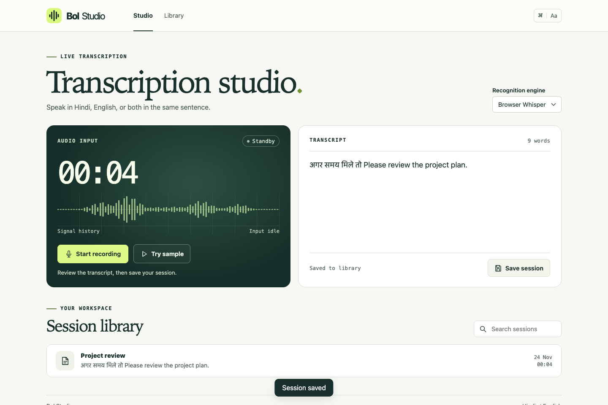

# Bol Studio

A live Hindi–English transcription desk. Speak a sentence, watch phrases arrive, correct the text, and keep the session in a searchable SQL-backed library. **Try sample** plays a synthetic bilingual recording through the same capture and inference pipeline as the microphone.



**[Open the public demo](https://bol-studio-hinglish.murari-s536553.chatgpt.site)** and choose **Try sample**. The first run downloads about 250 MB of model weights. Saved sessions belong to the current browser workspace.

## Start in one command

With **Node 22.16 or newer**, run this in the repository directory.

```sh
npm start
```

Open **http://127.0.0.1:8765** in a current desktop Chrome browser. This runs the web server and SQLite with Node built-ins. The browser engine fetches its pinned open-source model and runtime on first use. Allow the download to finish. Subsequent sessions can reuse the browser cache. Click **Try sample** for a microphone-free demo, or **Start recording** and grant microphone access. Use localhost or HTTPS for audio capture.

## Run the self-hosted recognizer

This is the configuration used for the higher-accuracy demo. It uses multilingual Whisper Large v3 Turbo, loaded once into a CPU process with INT8 inference. Allow roughly 1.7 GB of disk space for model files, plus RAM for inference. Python 3.12 was used for verification.

In one terminal, from the repository root:

```sh
python3.12 -m venv .venv
. .venv/bin/activate
python -m pip install -r speech/requirements.txt
python speech/service.py
```

Wait for the speech service to report ready. First launch downloads the public weights. In another terminal, start the web app with its same-origin speech proxy:

```sh
BOL_WHISPER_URL=http://127.0.0.1:8766/transcribe npm start
```

If the browser-only server is already running on port 8765, stop that process first. The page now defaults to **Self-hosted Whisper**. Audio travels to your own Python process and is released after decoding. The library stores text and session metadata in `.data/studio.sqlite`. Set `BOL_DATA` to choose a persistent directory. `PORT`, `BOL_SPEECH_PORT`, `BOL_MODEL` and `BOL_THREADS` configure the two services. A local CTranslate2 model directory is also valid for `BOL_MODEL`.

## Demo in 90 seconds

1. Click **Try sample**. Listen for “अगर समय मिले तो please review the project plan.” Compare the words on screen with what you hear.
2. Click **Save session**. Give it a title and correct any recognition errors. Reload the page and find the title in **Session library**.
3. Open the row, edit the transcript, and search for a word from the edit. Try **Delete session**, cancel once, then confirm.
4. Click **Start recording** and say “आज हमारी team meeting है. Please share the update.” Pause briefly between thoughts. A phrase can appear while the microphone is still open. Stop to flush the last phrase.

## Architecture

```text
microphone or sample WAV
    → Web Audio at 16 kHz → AudioWorklet → phrase queue
        → browser worker → Whisper ONNX / WASM
        → OR same-origin POST /api/speech → loopback faster-whisper
    → incremental transcript → review and explicit save
    → session API → SQLite locally / D1 in the cloud
```

| Code | What to follow |
| --- | --- |
| `public/capture.js`, `public/phrases.js` | 32 ms audio frames, energy gate, pause detection and final flush |
| `public/recording.js` | Microphone permissions, sample playback, queue ordering, stop, retry and cleanup |
| `public/whisper-worker.js`, `speech/service.py` | The two actual open-source inference engines |
| `server/api.mjs` | Shared parameterized SQL, validation, ownership checks, idempotent create and revision checks |
| `server/local.mjs`, `server/cloud.mjs` | Node/SQLite runtime and portable Cloudflare Worker/D1 adapter |
| `public/studio.js` | Draft lifecycle, library search, edit and delete confirmation |

One opaque HttpOnly cookie identifies a browser workspace. Each query is scoped to its hash. Clearing the cookie loses access to that browser’s saved sessions. The app has no cross-device accounts. The database contains the saved text in plaintext, so the operator controls its retention and backups.

## Tests and walkthrough

```sh
npm test
```

The built-in Node test suite covers mixed Unicode CRUD, repeated saves, stale edits and deletes, workspace isolation, validation, silence, continuous speech and tail flushing. See the [verification notes and interview guide](docs/walkthrough.md) for observed model output, tradeoffs, and what to demonstrate.

## Deployment

A cloud instance can serve the browser engine without an inference key or GPU. The local and hosted APIs use the same SQL and revision checks. To reproduce it on a Cloudflare account, bind a D1 database as `DB`, bind `public/` as static `ASSETS`, and use `server/cloud.mjs` as the Worker entry point. Apply `server/schema.sql` before deploying. A [Wrangler configuration example](wrangler.example.jsonc) includes the required bindings. The self-hosted Python engine requires a CPU host with persistent model storage.

## Credits and AI assistance

The speech engines use [faster-whisper](https://github.com/SYSTRAN/faster-whisper), [Whisper](https://github.com/openai/whisper), and [Transformers.js](https://github.com/huggingface/transformers.js). The bundled recording is synthesized from an original sentence with the [Hindi Rohan](https://huggingface.co/rhasspy/piper-voices/tree/main/hi/hi_IN/rohan/medium) and [English Lessac](https://huggingface.co/rhasspy/piper-voices/tree/main/en/en_US/lessac/medium) Piper voices. The voice models are fetched separately for fixture generation and are excluded from the repository.

OpenAI Codex helped design and implement the app, build the test fixture, run checks, and draft the documentation. The speech models are pretrained. The verification notes record machine-run checks. A personal microphone rehearsal remains part of interview preparation.
